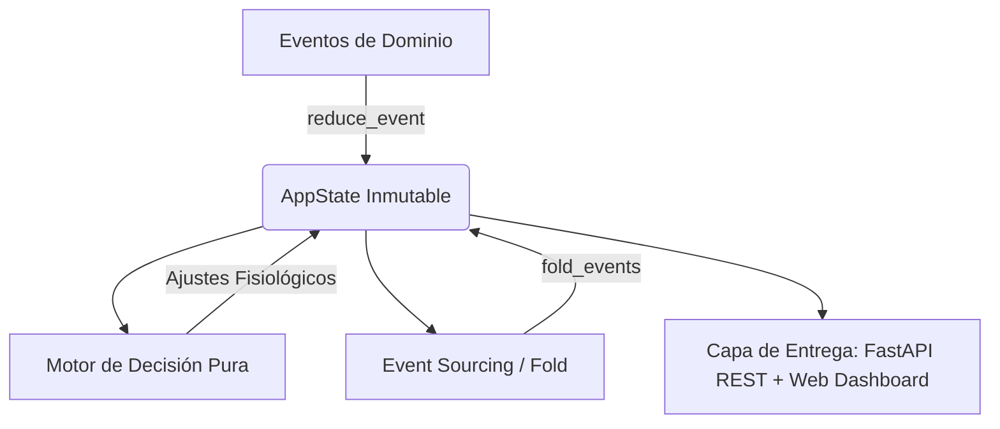

# 🏋️ GymFit Agent — Sistema Agéntico Funcional de Entrenamiento Personalizado

> **Sistema Agéntico de Inteligencia Artificial basado en Arquitectura Funcional Pura, Inmutabilidad Estricta y Event Sourcing para la prescripción y adaptación continua de entrenamiento físico.**

---

## 📌 1. Visión General del Proyecto

La inmensa mayoría de las aplicaciones y rutinas de entrenamiento disponibles en el mercado asumen un entorno "ideal" con maquinaria de última generación y equipamiento estándar. Sin embargo, en el mundo real:
- **Cada gimnasio cuenta con equipamiento dispar o limitado** (faltan barras específicas, poleas o máquinas guidas).
- **Los usuarios sufren imprevistos y variabilidad constante**: molestias articulares inesperadas, escasez de tiempo en días específicos, falta de descanso o días de inasistencia forzada.
- **Las rutinas tradicionales son estáticas y rígidas**: no evolucionan con el usuario ni se adaptan reactivamente a las condiciones reales del entrenamiento.

**GymFit Agent** resuelve este problema construyendo un **agente de prescripción reactivo** que:
1. **Analiza el equipamiento real disponible** y aplica filtrado estricto de seguridad articular.
2. **Genera planes de entrenamiento personalizados** (splits semanales deterministas) basados en el perfil, nivel y disponibilidad semanal.
3. **Reacciona dinámicamente ante eventos del día a día** (molestias físicas, poco tiempo, sobrecarga por percepción de esfuerzo o ausencias prolongadas) recalculando la rutina sin perder la progresión histórica ni reiniciar el plan.

---

## 📐 2. Pilares Arquitectónicos y Paradigma Funcional

El diseño del agente se fundamenta en principios formales de la **Programación Funcional** y patrones de ingeniería de software orientados a la confiabilidad:



### Principios Clave:
* **Inmutabilidad Absoluta:** Todas las estructuras de datos (`AppState`, `UserProfile`, `WeeklyRoutine`, `SessionLog`) son `dataclasses(frozen=True)` y utilizan tuplas y `frozenset`. Ningún estado muta en memoria tras ser creado.
* **Reductor de Estado Puro (`reduce_event`):** Toda evolución del sistema responde a la signatura matemática pura `(Estado, Evento) -> NuevoEstado`, implementada con *Structural Pattern Matching* (`match-case`) y `dataclasses.replace()`.
* **Event Sourcing y Determinismo (`fold_events`):** El estado global de la aplicación puede destruirse y reconstruirse íntegramente a partir del registro secuencial inmutable de eventos pasados mediante una operación de reducción (`foldl`).
* **Cero Efectos Secundarios en el Dominio:** Ni el motor de inferencia de rutinas ni el reductor realizan operaciones de I/O, mutaciones de variables globales ni llamadas asíncronas no deterministas.

---

## 📂 3. Estructura del Proyecto

```text
proyecto_ia_agentica/
├── README.md                      # Esta documentación técnica y manual general
├── documentacion.md               # Bitácora y especificación técnica exhaustiva
├── propuesta_proyecto_final.md    # Propuesta formal y alcance del proyecto
├── bitacora_proyecto_ia.md        # Registro cronológico de hitos y sesiones de trabajo
│
├── run_server.bat                 # Script de arranque del servidor FastAPI
├── run_demo_cli.bat               # Script para ejecutar la demostración CLI
├── run_tests.bat                  # Script de ejecución de la suite de pruebas
│
├── data/                          # Catálogos base en formato JSON
│   ├── table_a_levels.json        # Parámetros fisiológicos y volumen por nivel
│   ├── table_b_splits.json        # Plantillas de división semanal de entrenamiento
│   ├── table_b_exercises.json     # Catálogo base de ejercicios, técnicas y articulaciones
│   └── external/                  # Datasets externos enriquecidos
│       └── free-exercise-db/      # Repositorio clonado con 873+ ejercicios y multimedia
│
├── src/                           # Código fuente del sistema
│   ├── main.py                    # Simulación CLI completa del ciclo de vida del agente
│   │
│   ├── models/                    # Modelos de datos inmutables y eventos
│   │   ├── enums.py               # Enumeraciones de dominio (niveles, objetivos, articulaciones)
│   │   ├── profile.py             # Modelo de perfil de usuario
│   │   ├── catalog.py             # Modelos de ejercicios, splits y tablas fisiológicas
│   │   ├── routine.py             # Modelo de rutina semanal y asignación de ejercicios
│   │   ├── events.py              # Definición de los 11 eventos de dominio (DomainEvent)
│   │   └── state.py               # Modelo del estado inmutable global (AppState)
│   │
│   ├── catalog/                   # Carga y filtrado de ejercicios
│   │   ├── loader.py              # Cargador puro y validado de archivos JSON
│   │   └── filters.py             # Filtros bicondicionales de equipamiento y articulaciones
│   │
│   ├── engine/                    # Motor de inferencia y toma de decisiones
│   │   ├── split_selector.py      # Selector determinista de plantillas de división semanal
│   │   ├── generator.py           # Generador de rutinas con selección de técnica y sustitutos
│   │   ├── adjuster.py            # Adaptadores reactivos ante imprevistos, molestias y esfuerzo
│   │   └── explainer.py           # Generador de explicaciones en lenguaje natural para el usuario
│   │
│   ├── reducer/                   # Lógica funcional de transición de estados
│   │   ├── state_reducer.py       # Reductor funcional match-case con dataclasses.replace
│   │   └── history_fold.py        # Reconstructor de estado por pliegue de eventos (Fold)
│   │
│   └── api/                       # Capa web y servicios REST (FastAPI)
│       ├── app.py                 # Aplicación FastAPI y montaje de rutas
│       ├── state_manager.py       # Gestor en memoria del ciclo de vida del estado
│       ├── schemas.py             # Esquemas Pydantic V2 para request/response de la API
│       ├── dashboard_html.py      # Interfaz visual interactiva web SPA (HTML5/Vanilla CSS/JS)
│       └── routers/               # Controladores modulares por entidad
│           ├── profile.py         # Endpoints de creación y consulta de perfil
│           ├── equipment.py       # Endpoints de registro y actualización de equipo
│           ├── routine.py         # Endpoints de generación y consulta de rutina activa
│           ├── session.py         # Endpoints de inicio, registro de series y fin de sesión
│           ├── variability.py     # Endpoints de reporte de molestias, imprevistos y dificultad
│           └── events.py          # Endpoints de historial de eventos y reconstrucción por fold
│
└── tests/                         # Suite de pruebas automatizadas con pytest
    ├── test_filters.py            # Pruebas de filtrado por equipo, nivel y articulaciones
    ├── test_generator.py          # Pruebas del generador de rutinas y selección de splits
    ├── test_reducer.py            # Pruebas de inmutabilidad, ciclo de sesión y fold_events
    └── test_api.py                # Pruebas de integración de la API REST y endpoints FastAPI
```

---

## 🧠 4. Módulos del Sistema y Funcionamiento

### 4.1. Catálogos y Datos Fisiológicos (`data/`)
* **Tabla A (`table_a_levels.json`):** Establece los rangos de volumen, series, repeticiones, descansos y porcentajes de ajuste según el nivel de experiencia del atleta (`principiante`, `intermedio`, `avanzado`).
* **Tabla B - Splits (`table_b_splits.json`):** Plantillas de distribución semanal optimizadas para 2, 3, 4, 5 y 6 días (ej. *Fullbody*, *Torso/Pierna*, *Push/Pull/Legs*).
* **Tabla B - Ejercicios (`table_b_exercises.json`):** Catálogo enriquecido de movimientos con identificadores, patrón de movimiento, nivel requerido, equipo indispensable, articulaciones involucradas y técnicas de ejecución seguras.
* **Dataset Externo (`data/external/free-exercise-db/`):** Base de datos libre con más de 870 ejercicios con recursos multimedia (GIFs instructivos, instrucciones paso a paso y metadatos) lista para enriquecer las futuras vistas del sistema.

### 4.2. Filtrado Bicondicional y Seguridad Articular (`src/catalog/filters.py`)
Garantiza que ningún ejercicio propuesto requiera equipo ausente en el gimnasio del usuario y excluye dinámicamente ejercicios que estresen articulaciones reportadas con molestia:
$$\text{Elegible}(e) \iff (\text{Equipo}(e) \subseteq \text{EquipoDisponible}) \land (\text{Articulaciones}(e) \cap \text{ArticulacionesComprometidas} = \emptyset) \land (\text{Nivel}(e) \le \text{NivelUsuario})$$

### 4.3. Motor de Inferencia y Generación (`src/engine/`)
* **`split_selector.py`:** Selecciona la plantilla óptima basándose en la disponibilidad semanal y nivel.
* **`generator.py`:** Distribuye los ejercicios seleccionando los compuestos principales y accesorios, asignando cargas iniciales estimadas, número de series, repeticiones y tiempo de descanso, anexando además alternativas biomecánicas viables.
* **`adjuster.py`:** Funciones puras que procesan eventos de variabilidad:
  - **Molestia articular:** Sustituye el ejercicio problemático por una alternativa segura del catálogo elegible sin comprometer el grupo muscular.
  - **Poco tiempo:** Comprime la sesión objetivo ajustando volumen y descansos a versiones exprés de 25-30 minutos.
  - **Dificultad reportada:** Aplica sobrecarga progresiva (+2.5% a +5% de carga si fue muy fácil) o descarga regulada si resultó muy difícil.
  - **Ausencias:** Reorganiza el calendario y ajusta intensidades de reingreso para evitar sobreentrenamiento o lesiones.

### 4.4. Reductor y Event Sourcing (`src/reducer/`)
* **`state_reducer.py`:** Procesa de forma atómica cada `DomainEvent` mediante `match-case`, utilizando `dataclasses.replace(state, ...)` para retornar una nueva instancia inmutable de `AppState`.
* **`history_fold.py`:** Demuestra la idempotencia y pureza del sistema permitiendo ejecutar:
  ```python
  estado_reconstruido = fold_events(historial_de_eventos, catalogo)
  ```
  garantizando que el estado derivado del pliegue coincide exactamente con el estado alcanzado paso a paso.

---

## 🌐 5. API REST y Dashboard Web

El proyecto incluye un servidor de producción basado en **FastAPI** (`src/api/app.py`).

### 5.1. Dashboard Web Integrado
Al acceder a `http://localhost:8000/`, se presenta una interfaz interactiva con:
* **Módulo de Perfil y Equipamiento:** Formulario de registro y selección de equipo disponible.
* **Visor de Rutina Activa:** Desglose día por día de ejercicios, series, repeticiones, técnica y sustitutos.
* **Consola de Variabilidad y Eventos:** Reporte en tiempo real de molestias articulares, falta de tiempo, dificultad y ausencias.
* **Cronómetro y Registro de Sesión:** Conteo de descansos y registro de series realizadas en vivo.
* **Inspector de Estado y Event Sourcing:** Visualización del historial de eventos y botón para verificar la reconstrucción matemática por fold.

### 5.2. Documentación Interactiva de la API
* **Swagger UI:** `http://localhost:8000/docs`
* **ReDoc:** `http://localhost:8000/redoc`

### 5.3. Principales Endpoints
| Método | Endpoint | Descripción |
|---|---|---|
| `GET` | `/` | Servidor del Dashboard Web interactivo |
| `GET` | `/health` | Verificación de salud del servidor y estado del catálogo |
| `POST` | `/api/v1/profile` | Registro o actualización inmutable del perfil del atleta |
| `POST` | `/api/v1/equipment` | Declaración del equipamiento disponible en el gimnasio |
| `POST` | `/api/v1/routine/generate` | Generación reactiva de la rutina semanal personalizada |
| `GET` | `/api/v1/routine/active` | Consulta del plan de entrenamiento semanal activo |
| `POST` | `/api/v1/session/start` | Apertura de una nueva sesión de entrenamiento |
| `POST` | `/api/v1/session/set` | Registro inmutable de una serie completada con descansos |
| `POST` | `/api/v1/session/finish` | Cierre de sesión y cálculo de duración total |
| `POST` | `/api/v1/variability/difficulty`| Reporte de dificultad percibida con sobrecarga progresiva |
| `POST` | `/api/v1/variability/discomfort`| Reporte de molestia articular y sustitución de ejercicio |
| `POST` | `/api/v1/variability/time-crunch`| Ajuste exprés por tiempo limitado |
| `GET` | `/api/v1/events/history` | Consulta del historial ordenado de eventos de dominio |
| `POST` | `/api/v1/events/fold-verify` | Ejecución de `fold_events()` y verificación de determinismo |

---

## 🚀 6. Instalación y Puesta en Marcha

### Prerrequisitos
* **Python 3.10 o superior** (probado y validado en Python 3.14).
* Sistema Operativo Windows, macOS o Linux.

### Instalación de Dependencias
En la raíz del proyecto, instala las librerías necesarias:
```powershell
pip install fastapi uvicorn pydantic pytest httpx
```

### Ejecución Rápida mediante Scripts Batch (Windows)
El proyecto incluye scripts ejecutables con doble clic o desde terminal:
1. **Iniciar Servidor Web y API:**
   ```powershell
   .\run_server.bat
   ```
   *Acceso inmediato en el navegador:* `http://localhost:8000/` y `http://localhost:8000/docs`.

2. **Ejecutar Demostración CLI:**
   ```powershell
   .\run_demo_cli.bat
   ```
   *Ejecuta la simulación determinista completa por consola mostrando la generación y adaptación de rutinas.*

3. **Ejecutar Suite de Pruebas Automatizadas:**
   ```powershell
   .\run_tests.bat
   ```
   *Corre la suite de 12 pruebas unitarias y de integración.*

---

## 🧪 7. Pruebas y Aseguramiento de Calidad

La confiabilidad del agente está respaldada por pruebas automatizadas con `pytest`:
* **`tests/test_filters.py`:** Valida que el filtrado bicondicional respete estrictamente el equipamiento, excluya articulaciones con dolor y restrinja movimientos por nivel de habilidad.
* **`tests/test_generator.py`:** Verifica la integridad estructural de la rutina semanal, consistencia de días y selección de splits según la disponibilidad semanal.
* **`tests/test_reducer.py`:** Garantiza la inmutabilidad de `AppState`, la gestión del ciclo de vida de las sesiones y la equivalencia matemática estricta entre transiciones paso a paso y la reconstrucción mediante `fold_events()`.
* **`tests/test_api.py`:** Pruebas de integración extremo a extremo sobre los endpoints REST de FastAPI.

Para ejecutar los tests manualmente:
```powershell
python -m pytest tests/ -v
```

---

## 🔮 8. Próximos Pasos y Roadmap

1. **Visión Computacional para Detección de Equipo:** Incorporación de modelos multimodales (ej. Gemini Vision / YOLO) para reconocer automáticamente máquinas, mancuernas y accesorios a partir de fotografías tomadas en el gimnasio.
2. **Aplicación Móvil:** Desarrollo de cliente multiplataforma (React Native / Flutter) que consuma la API REST para el registro offline en sala de pesas.
3. **Módulo de Nutrición Agéntica:** Expansión del agente para vincular el gasto calórico de la rutina generada con planes de alimentación y ajuste dinámico de macronutrientes.
