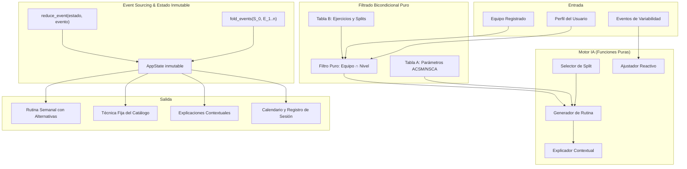
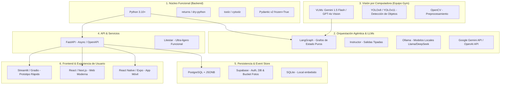
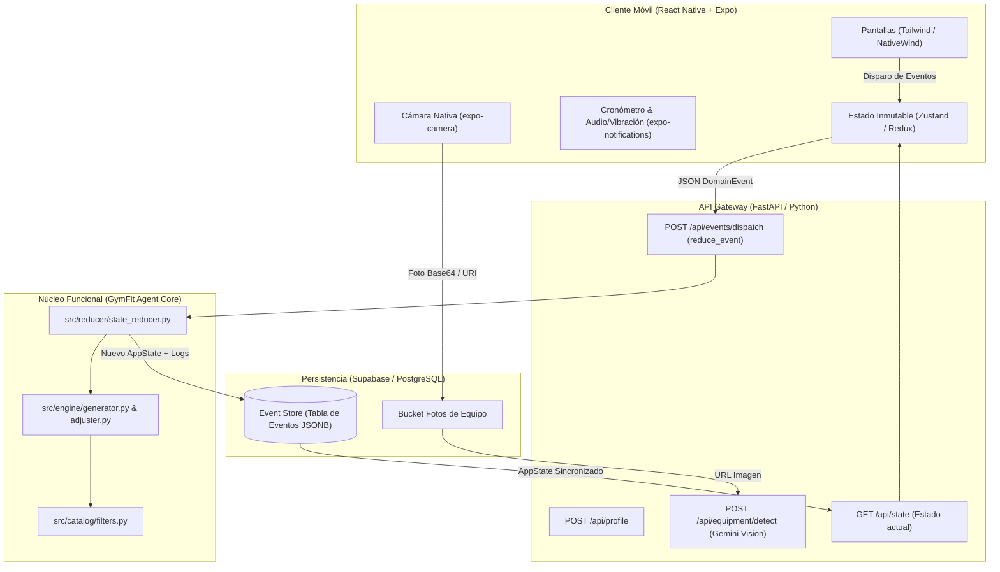

# Documentación Técnica y Didáctica — GymFit Agent

Bienvenido a la documentación técnica oficial de **GymFit Agent**, un agente de inteligencia artificial agéntica diseñado bajo los fundamentos del **Paradigma de Programación Funcional** en Python 3.14+.

Este documento explica paso a paso, con enfoque pedagógico, la arquitectura, los modelos inmutables, las funciones puras, los tipos algebraicos discriminados y el patrón de reducción de eventos (*Event Sourcing / Fold*) implementados en el núcleo del sistema.

---

## 1. Visión General del Sistema

**GymFit Agent** es un sistema agéntico inteligente que construye y adapta rutinas de entrenamiento físico personalizadas en función de:
1. **El equipo real disponible** en el gimnasio del usuario (sin asumir máquinas inexistentes).
2. **El perfil del usuario** (nivel de experiencia, objetivo corporal y disponibilidad de días).
3. **La variabilidad del día a día** (molestias físicas, dificultades percibidas, falta de tiempo o ausencias).

A diferencia de las rutinas estáticas convencionales, el agente reacciona y adapta el plan de forma continua preservando siempre la coherencia del entrenamiento.



---

## 2. Pilares de Programación Funcional Aplicados

| Principio Funcional | Implementación en GymFit Agent | Beneficio Académico y Práctico |
| :--- | :--- | :--- |
| **Inmutabilidad de Datos** | `@dataclass(frozen=True)`, `tuple`, `frozenset` | Previene efectos secundarios indeseados y mutaciones accidentales del perfil, rutina o historial. |
| **Funciones Puras** | Determinismo sin variables globales ni I/O oculto | La misma entrada siempre genera la misma salida exacta. Totalmente testeable. |
| **Tipos Algebraicos (ADTs)** | `type DomainEvent = PerfilCreado \| ...` | Modela cada evento como un tipo discriminado seguro y exhaustivo. |
| **Pattern Matching Estructural** | `match event: case ...` | Desestructuración limpia y elegante en el reductor sin cadenas de `isinstance`. |
| **Event Sourcing / Fold** | `functools.reduce` | Reconstrucción determinista del estado: $S_n = \text{foldl}(f, E_{1..n}, S_0)$. |
| **Composición y Filtros** | Tuberías de funciones (`filter`, composición) | Filtrado bicondicional de catálogos: $C_{\text{elegible}} = f_{\text{nivel}}(f_{\text{equipo}}(C))$. |

---

## 3. Catálogos del Sistema (Separación de Tablas A y B)

El sistema distingue estrictamente entre hechos del mundo y reglas dependientes del usuario:

### Tabla A — Parámetros por Nivel (`data/table_a_levels.json`)
Basado en consensos de la ACSM (*American College of Sports Medicine*) y la NSCA (*National Strength and Conditioning Association*):
- **Principiante:** 2-3 series, 10-15 repeticiones, 90s descanso, 2.5% progresión semanal, restricción de levantamientos de alta complejidad técnica (snatch, trasnuca).
- **Intermedio:** 3-4 series, 8-12 repeticiones, 120s descanso, 5.0% progresión semanal.
- **Avanzado:** 4-5 series, 6-10 repeticiones, 150s descanso, alta densidad e intensificación.

### Tabla B — Ejercicios y Splits (`data/table_b_exercises.json` y `data/table_b_splits.json`)
- **Ejercicios:** Nombre, grupo muscular, patrón de movimiento, equipo requerido (`frozenset`), nivel mínimo, nivel de riesgo, articulaciones comprometidas, técnica fija inmutable, errores comunes y precauciones.
- **Splits:** Plantillas semanales de 2, 3, 4, 5 y 6 días (Fullbody, Torso/Pierna, Push/Pull/Legs).

---

## 4. Documentación Detallada de Módulos y Código

### 4.1. Módulo de Modelos (`src/models/`)

#### `src/models/enums.py`
Enumeraciones tipadas que heredan de `str, Enum` para serialización limpia:
- `GoalEnum`: Metas (`BAJAR_GRASA`, `GANAR_MUSCULO`, `MANTENIMIENTO`, `FUERZA`).
- `LevelEnum`: Niveles (`PRINCIPIANTE`, `INTERMEDIO`, `AVANZADO`).
- `SexEnum`: Sexo biológico (`MASCULINO`, `FEMENINO`, `OTRO`).
- `MuscleGroupEnum`: Grupos musculares (`PECHO`, `ESPALDA`, `HOMBROS`, `CUADRICEPS`, etc.).
- `MovementPatternEnum`: Patrones biomecánicos (`EMPUJE`, `TRACCION`, `DOMINANTE_RODILLA`, etc.).
- `RiskLevelEnum`: Niveles de riesgo articular (`BAJO`, `MEDIO`, `ALTO`).
- `DifficultyPerceptionEnum`: Percepción (`MUY_FACIL`, `ADECUADO`, `MUY_PESADO`, `FALLO_PREMATURO`).
- `UnforeseenTypeEnum`: Imprevistos (`POCO_TIEMPO`, `MAL_SUENO`, `AUSENCIA_PASADA`, `EVENTO_SOCIAL`).

#### `src/models/profile.py` — `UserProfile`
Estructura inmutable que encapsula los datos del atleta:
- **Campos Fijos:** `nombre: str`, `sexo: SexEnum`.
- **Campos Editables:** `peso_kg: float`, `altura_cm: float`, `objetivo: GoalEnum`, `nivel: LevelEnum`, `dias_disponibles: int`.
- **Invariantes:** Valida en `__post_init__` que los rangos numéricos sean estrictamente positivos y coherentes. Propiedad pura `imc` para el cálculo del índice de masa corporal.

#### `src/models/catalog.py`
- `LevelParameters`: Modela la Tabla A.
- `Exercise`: Modela un ejercicio de la Tabla B con su técnica fija.
- `SplitTemplate` y `DailySplitScheme`: Modela plantillas de división muscular por día.
- `Catalog`: Contenedor inmutable de ambas tablas.

#### `src/models/routine.py`
- `ExerciseExecutionDetail`: Parámetros sugeridos de carga, series y descanso + técnica fija inmutable.
- `WorkoutSlot`: Ranura de entrenamiento compuesta por 1 ejercicio principal y 1-2 alternativas seguras.
- `DailyWorkout`: Día de entrenamiento con su lista inmutable de ranuras y duración estimada.
- `WeeklyRoutine`: Rutina semanal completa generada por el agente con su justificación contextual.

#### `src/models/events.py` — Álgebra de Eventos
Modela los 11 eventos del sistema como Dataclasses inmutables agrupadas en el tipo algebraico:
```python
type DomainEvent = (
    PerfilCreado
    | EquipoRegistrado
    | EquipoActualizado
    | RutinaGenerada
    | SesionIniciada
    | SerieRegistrada
    | SesionFinalizada
    | DificultadReportada
    | MolestiaReportada
    | ImprevistoReportado
    | AusenciaDetectada
)
```

#### `src/models/state.py` — `AppState`
Estado inmutable de la aplicación:
```python
@dataclass(frozen=True)
class AppState:
    perfil: UserProfile | None = None
    equipo_disponible: frozenset[str] = frozenset()
    rutina_actual: WeeklyRoutine | None = None
    sesion_en_curso: SessionLog | None = None
    historial_sesiones: tuple[SessionLog, ...] = ()
    calendario: tuple[CalendarEntry, ...] = ()
    historial_ajustes: tuple[AdjustmentLog, ...] = ()
    historial_eventos: tuple[DomainEvent, ...] = ()
```

---

### 4.2. Módulo de Catálogo y Filtrado (`src/catalog/`)

#### `src/catalog/filters.py`
Implementa el filtrado funcional bicondicional:
1. `filter_by_equipment(exercises, available_equipment)`: Comprueba si `ex.equipo_requerido ⊆ available_equipment ∪ {'peso_corporal'}`.
2. `filter_by_level(exercises, user_level, restricted_ids)`: Aplica la jerarquía de niveles y excluye ejercicios restringidos por la Tabla A.
3. `filter_by_joint_safety(exercises, painful_joint)`: Excluye ejercicios cuyas articulaciones comprometidas incluyan la zona con molestia.
4. `get_eligible_catalog(...)`: Composición pura:
   $$\text{Catálogo Elegible} = \text{filter\_by\_level}(\text{filter\_by\_equipment}(\text{Catálogo}, \text{Equipo}), \text{Nivel})$$

---

### 4.3. Módulo del Motor de Decisión (`src/engine/`)

#### `src/engine/split_selector.py`
Función pura `select_split_template(splits, dias_disponibles, objetivo)` que selecciona la división adecuada (Fullbody para $\le 3$ días, Torso/Pierna para 4 días, PPL para $\ge 5$ días).

#### `src/engine/generator.py`
Generador funcional `generate_routine(perfil, eligible_catalog, level_params, split_template, timestamp)`:
- Asigna para cada ranura muscular un ejercicio principal y 1-2 alternativas viables.
- Inyecta los parámetros de volumen de la Tabla A y fija la técnica de seguridad de la Tabla B.
- Estima la duración total en minutos sumando tiempo de ejecución y descansos.
- Invoca al explicador para construir la justificación contextual inicial.

#### `src/engine/adjuster.py`
Funciones puras de adaptación que devuelven `(nueva_rutina, detalle_ajuste)`:
1. `adjust_for_discomfort(...)`: Sustituye ejercicios que comprometen articulaciones con dolor por alternativas seguras o reduce carga/volumen preventivamente.
2. `adjust_for_time_crunch(...)`: Comprime las series a 2 por ejercicio y acorta descansos ante falta de tiempo.
3. `adjust_for_difficulty(...)`: Aplica sobrecarga progresiva (+2.5% a +5%) si el ejercicio resultó muy fácil o descarga (-10%) si fue excesivamente pesado.
4. `adjust_for_absence(...)`: Modula las series iniciales con mayor RIR para readaptación motora.

#### `src/engine/explainer.py`
Genera justificaciones en lenguaje natural explicando *por qué* se eligió una rutina o *qué cambió y por qué* tras cada evento.

---

### 4.4. Módulo de Reducción y Event Sourcing (`src/reducer/`)

#### `src/reducer/state_reducer.py`
La función reductora pura:
```python
def reduce_event(state: AppState, event: DomainEvent, catalog: Catalog) -> AppState:
    match event:
        case PerfilCreado(perfil=p):
            return replace_or_create(state, perfil=p)
        case EquipoRegistrado(equipo=eq):
            return replace_or_create(state, equipo_disponible=eq)
        case MolestiaReportada() as mol:
            nueva_rutina, detalle = adjust_for_discomfort(...)
            return replace_or_create(state, rutina_actual=nueva_rutina, ...)
        # ... exhaustividad para cada evento
```

#### `src/reducer/history_fold.py`
Aplica el fold funcional sobre toda la secuencia de eventos:
```python
def fold_events(initial_state: AppState, events: Sequence[DomainEvent], catalog: Catalog) -> AppState:
    return functools.reduce(
        lambda s, e: reduce_event(s, e, catalog),
        events,
        initial_state
    )
```

---

## 5. Pruebas Unitarias y Validación

El sistema cuenta con una suite completa de pruebas unitarias (`tests/`):
- `tests/test_filters.py`: Verifica el filtrado bicondicional, seguridad articular y jerarquía de niveles.
- `tests/test_generator.py`: Verifica la integridad de la rutina generada, la técnica fija de catálogo y la exclusividad del equipo disponible.
- `tests/test_reducer.py`: Demuestra la inmutabilidad estricta del estado, el ciclo de vida de sesiones y la equivalencia matemática del `fold_events`.

Para ejecutar las pruebas:
```bash
python -m unittest discover -s tests -v
```

Para ejecutar la simulación de consola:
```bash
python src/main.py
```

---

## 6. Ecosistema Tecnológico y Opciones de Implementación

Para llevar **GymFit Agent** desde este núcleo funcional en consola hacia un producto agéntico completo, se pueden incorporar las siguientes tecnologías divididas por capas de especialidad:



### Detalle por Área Tecnológica

1. **Ampliación del Paradigma Funcional en Python:**
   - **`returns` (`dry-python`):** Introduce tipos monádicos formales como `Result[Value, Error]`, `Maybe` e `IO` para manejo funcional de fallos sin lanzar excepciones mutables.
   - **`toolz` / `cytoolz`:** Biblioteca de funciones de orden superior (`compose`, `curry`, `pipe`, `valmap`, `partition`).
   - **`pydantic (frozen=True)`:** Validación estricta y tipado inmutable con autogeneración de esquemas JSON.

2. **IA Agéntica y Modelos de Lenguaje (LLMs):**
   - **`LangGraph` (Muy recomendado):** Diseñado específicamente sobre conceptos de *StateGraph* y transiciones de estado funcionales (nodos como funciones puras `State -> State`). Encaja al 100% con nuestra arquitectura de eventos y reducción.
   - **`Instructor`:** Permite forzar a los LLMs a responder exclusivamente en dataclasses/pydantic validadas.
   - **Modelos:** Google Gemini 1.5 Flash (alta velocidad y ventana de contexto amplia), Claude 3.5 Sonnet, o locales con **Ollama** (Llama 3.1 / Mistral) para privacidad y costo cero.

3. **Reconocimiento de Fotos de Gimnasio (Computer Vision):**
   - **Modelos Multimodales (VLM - Zero Shot):** Enviar las fotos directamente a Gemini Vision / GPT-4o con un prompt estructurado pidiendo identificar la lista de equipo con formato JSON (`["mancuernas", "banco_plano", "maquina_prensa"]`). Es la vía más rápida y precisa.
   - **Visión Clásica / YOLOv8 / YOLOv11:** Entrenar un modelo especializado de detección de objetos con Roboflow (detecta cajas delimitadoras de máquinas, barras y discos).

4. **Capa de Servicios y APIs:**
   - **FastAPI:** Estándar de la industria en Python: asíncrono, generación automática de documentación Swagger/OpenAPI, validación nativa con tipos.
   - **Litestar:** Alternativa moderna con fuerte enfoque en inmutabilidad y bajo acoplamiento.

5. **Interfaces de Usuario (Frontend):**
   - **Fase de Prototipado Académico:** **Streamlit** o **Gradio** (permite crear una app web interactiva completa en Python con sliders de peso, botones de eventos, carga de fotos y visualización de rutinas en menos de 100 líneas de código).
   - **Fase Web Profesional:** **React / Next.js** o **Vite** con Vanilla CSS / Tailwind (diseño oscuro de alto impacto, cronómetro animado, vista de calendario interactivo).
   - **Fase Móvil (Gimnasio Real):** **React Native + Expo** o **Flutter** (diseñado para registrar series y descanso directamente desde el teléfono mientras se entrena).

6. **Persistencia y Base de Datos (Event Store):**
   - **PostgreSQL:** Permite almacenar la tabla de eventos inmutables en un campo `JSONB` y hacer consultas analíticas rápidas.
   - **Supabase:** Base de datos Postgres en la nube con autenticación de usuarios y almacenamiento de imágenes (*Buckets*) para las fotos del gimnasio.

---

## 7. Diseño y Arquitectura de la Aplicación Móvil (GymFit Mobile)

La naturaleza del proyecto (entrenar en el gimnasio físico, tomar fotos de máquinas, cronometrar descansos entre series y reportar imprevistos al instante) hace que una **aplicación móvil nativa / multiplataforma** sea el formato definitivo idóneo.



### 7.1. Stack Móvil Recomendado

* **Framework Móvil:** **React Native** con **Expo** (TypeScript).
  * *Razón:* Multiplataforma (iOS y Android con una sola base de código), acceso directo a hardware (cámara, vibración, audio, almacenamiento local).
* **Gestor de Estado:** **Zustand** o **Redux Toolkit**.
  * *Alineación Funcional:* Ambos utilizan funciones reductoras puras `(state, action) => newState`, calcando exactamente el comportamiento de nuestro `reduce_event(state, event)` de Python.
* **Estilos y UI:** **NativeWind** (TailwindCSS para React Native) con tema oscuro deportivo de alto contraste.
* **Backend:** **FastAPI** en Python 3.10+ sirviendo el paquete `src/` que ya desarrollamos.

---

### 7.2. Desglose de las 6 Pantallas Clave

```text
┌────────────────────────────────────────────────────────────────────────┐
│                        FLUJO DE PANTALLAS MÓVILES                      │
└────────────────────────────────────────────────────────────────────────┘
  [1. Onboarding & Perfil] ──> [2. Escáner de Equipo] ──> [3. Dashboard Rutina]
                                                                │
  [6. Calendario & Historial] <── [5. Modal Ajuste Rápido] <────┤
                                                                │
                                              [4. Sesión en Vivo con Cronómetro]
```

1. **Pantalla 1: Onboarding y Perfil del Atleta (`/profile`):**
   - Selección de sexo, peso (kg), altura (cm), objetivo corporal (slider/selector) y días disponibles (1 a 7).
   - *Evento disparado:* `PerfilCreado`.

2. **Pantalla 2: Escáner de Equipo con Cámara (`/scanner`):**
   - El usuario abre la cámara, toma fotos panorámicas o individuales de las máquinas del gimnasio.
   - La foto se envía a la API; Gemini Vision detecta los aparatos y muestra una lista de verificación editable (*checkboxes*) para que el usuario confirme su inventario real.
   - *Evento disparado:* `EquipoRegistrado`.

3. **Pantalla 3: Dashboard de Rutina Semanal (`/routine`):**
   - Vista en tarjetas de los días del split (ej. "Día 1: Fullbody A", "Día 2: Fullbody B").
   - Cada ejercicio muestra sus series, repeticiones sugeridas, carga inicial y técnica fija.
   - Botón *"Alternativas"* en cada ejercicio para cambiar a otra opción segura sin salir de la app.
   - Botón destacado: **"Iniciar Entrenamiento de Hoy"**.

4. **Pantalla 4: Modo Sesión en Vivo y Cronómetro (`/active-session`):**
   - Vista enfocada diseñada para usarse mientras se entrena:
     - Nombre del ejercicio grande y técnica fija desplegable.
     - Inputs rápidos de Peso y Reps reales completadas.
     - Botón gigante: **"Completar Serie"** $\rightarrow$ Dispara automáticamente el **cronómetro de descanso con cuenta regresiva** (90s / 120s), vibración y sonido al finalizar.
   - *Eventos disparados:* `SesionIniciada`, `SerieRegistrada`, `SesionFinalizada`.

5. **Pantalla 5: Modal de Ajustes Rápidos en 1 Tap (`/quick-adjust`):**
   - Botones de acceso rápido para imprevistos:
     - 🩹 *"Tengo molestia física"* (selecciona articulación: hombro, rodilla, etc.).
     - ⏱️ *"Solo tengo 20/30 min hoy"* (activa versión exprés).
     - 📈 *"Estuvo muy fácil"* / *"Estuvo muy pesado"* (ajuste de sobrecarga).
   - *Eventos disparados:* `MolestiaReportada`, `ImprevistoReportado`, `DificultadReportada`.
   - El agente reajusta la rutina instantáneamente y muestra un globo con la explicación: *"Por tu molestia en el hombro, reemplacé Press Militar por Elevaciones Laterales"*.

6. **Pantalla 6: Calendario Mensual y Progreso (`/calendar`):**
   - Vista de calendario estilo cuadrícula (días entrenados en verde brillante, conteo mensual de sesiones y volumen total levantado en kg).

---

### 7.3. Ejemplo de Integración API (FastAPI) con React Native

En el backend (`server.py`), exponemos nuestro núcleo funcional:

```python
from fastapi import FastAPI
from src.catalog.loader import load_full_catalog
from src.catalog.filters import get_eligible_catalog
from src.engine.generator import generate_routine
from src.engine.split_selector import select_split_template
from src.reducer.state_reducer import reduce_event
from src.models.state import AppState
from src.models.events import DomainEvent

app = FastAPI(title="GymFit Agent API")
catalog = load_full_catalog("./data")
current_state = AppState()

@app.post("/api/events/dispatch")
def dispatch_event(event_data: dict):
    global current_state
    # 1. Deserializar el evento a su clase inmutable (DomainEvent)
    event = deserialize_event(event_data)
    # 2. Reducción pura de estado
    current_state = reduce_event(current_state, event, catalog)
    # 3. Retornar el nuevo estado inmutable al móvil
    return {"state": current_state, "latest_adjustments": current_state.historial_ajustes}
```

En la App Móvil (`useGymFitStore.ts` con Zustand):

```typescript
import { create } from 'zustand';

interface GymFitStore {
  state: AppState | null;
  dispatchEvent: (event: DomainEvent) => Promise<void>;
}

export const useGymFitStore = create<GymFitStore>((set) => ({
  state: null,
  dispatchEvent: async (event) => {
    const response = await fetch('https://api.gymfit.app/api/events/dispatch', {
      method: 'POST',
      headers: { 'Content-Type': 'application/json' },
      body: JSON.stringify(event),
    });
    const data = await response.json();
    // Actualización inmutable en el cliente
    set({ state: data.state });
  },
}));
```

---

## 8. Documentación de la API REST (FastAPI)

La capa de servicios web de **GymFit Agent** está implementada con **FastAPI** (`src/api/`), desacoplando el transporte HTTP del motor funcional puro.

### 8.1. Arranque del Servidor Local

Para iniciar el servidor de desarrollo con recarga automática:

```bash
uvicorn src.api.app:app --host 0.0.0.0 --port 8000 --reload
```

* **Documentación Interactiva Swagger:** `http://localhost:8000/docs`
* **Documentación ReDoc:** `http://localhost:8000/redoc`

---

### 8.2. Catálogo de Endpoints REST

| Método | Endpoint | Descripción | Evento Disparado |
| :--- | :--- | :--- | :--- |
| `POST` | `/api/profile` | Crea o actualiza el perfil inmutable del usuario. | `PerfilCreado` |
| `GET` | `/api/profile` | Consulta el perfil actual y el IMC calculado. | — |
| `POST` | `/api/equipment` | Registra o actualiza el equipo disponible. | `EquipoRegistrado` / `EquipoActualizado` |
| `GET` | `/api/equipment` | Consulta equipo registrado y cantidad de ejercicios viables. | — |
| `GET` | `/api/equipment/catalog` | Lista el inventario universal de tipos de equipo conocidos. | — |
| `POST` | `/api/routine/generate` | Genera la rutina semanal aplicando filtrado bicondicional. | `RutinaGenerada` |
| `GET` | `/api/routine` | Consulta la rutina activa y las explicaciones del agente. | — |
| `POST` | `/api/session/start` | Inicia una sesión de entrenamiento para un día del split. | `SesionIniciada` |
| `POST` | `/api/session/set` | Registra una serie completada con peso, reps y cronómetro. | `SerieRegistrada` |
| `POST` | `/api/session/finish` | Finaliza la sesión activa y actualiza el calendario mensual. | `SesionFinalizada` |
| `GET` | `/api/session/active` | Consulta el estado y series de la sesión en curso. | — |
| `GET` | `/api/session/history` | Consulta el historial de sesiones y días entrenados del mes. | — |
| `POST` | `/api/adjustments/discomfort` | Reporta molestia articular $\rightarrow$ Reemplazo seguro. | `MolestiaReportada` |
| `POST` | `/api/adjustments/time-crunch` | Reporta falta de tiempo $\rightarrow$ Versión exprés. | `ImprevistoReportado` |
| `POST` | `/api/adjustments/difficulty` | Reporta dificultad $\rightarrow$ Sobrecarga/descarga. | `DificultadReportada` |
| `GET` | `/api/adjustments/history` | Consulta todas las adaptaciones y justificaciones del agente. | — |
| `GET` | `/api/state` | Retorna el objeto inmutable global completo (`AppState`). | — |
| `GET` | `/api/state/events` | Retorna la traza histórica de eventos (*Event Sourcing*). | — |
| `POST` | `/api/state/reset` | Reinicia el estado a limpio para testing. | — |

---

### 8.3. Ejemplo de Petición HTTP (Reportar Molestia)

```http
POST /api/adjustments/discomfort HTTP/1.1
Host: localhost:8000
Content-Type: application/json

{
  "zona_articular": "hombro",
  "intensidad_1_a_10": 6,
  "ejercicio_origen_id": "press_plano_mancuernas"
}
```

**Respuesta JSON:**

```json
{
  "message": "Molestia procesada y rutina reajustada de forma pura.",
  "ajuste": {
    "timestamp": "2026-09-20 02:07:00",
    "motivo": "Dolor/molestia en hombro (Intensidad 6/10)",
    "detalle_ajuste": "Día 1: 'Press de Banca Plano con Mancuernas' sustituido por 'Flexiones de Pecho (Push-Ups)' para proteger hombro.",
    "evento_causante_tipo": "MolestiaReportada"
  },
  "explicacion_agente": "[Ajuste Adaptativo del Agente] Evento: MolestiaReportada..."
}
```

---

## 9. Panel Visual Interactivo y Base de Pruebas Continuas

Para facilitar la experimentación, pruebas y evolución del proyecto sin depender exclusivamente de llamadas a la API o de la consola, el sistema incluye un **Dashboard Web Interactivo** integrado directamente en FastAPI.

### 9.1. Acceso al Dashboard

Con el servidor encendido, ingresa desde tu navegador a:
* **`http://localhost:8000/`** o **`http://localhost:8000/dashboard`**

### 9.2. Capacidades de Prueba en el Dashboard:
1. **Precarga en 1 Clic (Botón "⚡ Cargar Caso Demo"):** Invoca `/api/state/seed` y puebla automáticamente un perfil (Carlos Mendoza, principiante, 3 días), su equipo disponible y genera la rutina con alternativas seguras.
2. **Selector Dinámico de Equipo (Chips):** Haz clic en los chips de máquinas/mancuernas/poleas para añadir o remover equipo en tiempo real y regenerar la rutina.
3. **Simulador de Cronómetro de Descanso:** Botones interactivos de cuenta regresiva (90s / 60s) con alerta auditiva al concluir el tiempo.
4. **Simulación de Variabilidad en 1 Clic:**
   - 🩹 **Molestia en Hombro / Rodilla:** Observa en vivo cómo el agente sustituye los ejercicios lesivos por alternativas no comprometidas y redacta la justificación.
   - ⏱️ **Falta de Tiempo (25 min):** Comprime las series del día a versión exprés.
   - 📈 **Dificultad (Muy Fácil / Muy Pesado):** Observa el incremento o decremento de peso (+2.5% o -10%) por sobrecarga progresiva.
5. **Inspección de Event Sourcing:** Registro cronológico visible en pantalla de todos los eventos (`DomainEvent`) acumulados en el estado inmutable.

---

### 9.3. Scripts Rápidos de Ejecución en Windows

En la raíz del proyecto se incluyeron scripts `.bat` para ejecutar las tareas más frecuentes con un solo doble clic:

* **`run_server.bat`:** Inicia el servidor FastAPI con Uvicorn y recarga automática (`--reload`).
* **`run_tests.bat`:** Ejecuta la suite completa de 12 pruebas unitarias e integración (`unittest`).
* **`run_demo_cli.bat`:** Ejecuta la simulación determinista por consola en Python puro.

---


